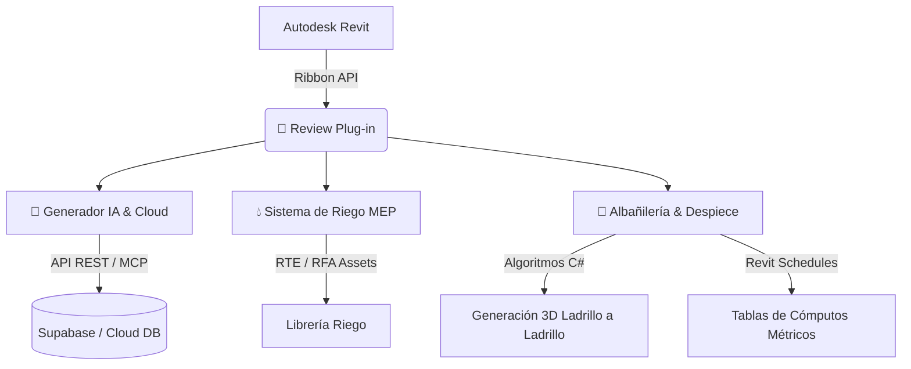

# 📕 Review Plug-in para Autodesk® Revit®

> **Suite avanzada de automatización BIM, Inteligencia Artificial, diseño de sistemas MEP (Riego) y modelado de alta precisión para Albañilería.**

---

## 📌 Descripción General

**Review Plug-in** es una extensión integral desarrollada en .NET para Autodesk Revit® diseñada para optimizar los flujos de trabajo de arquitectura e ingeniería. El complemento combina la potencia de **Inteligencia Artificial generativa**, conectividad en la nube mediante **Supabase/MCP**, automatización de **Sistemas de Riego (MEP)** y despiece geométrico avanzado de **Albañilería y Cómputos Métricos** en tiempo real.

---

## 🛠️ Desglose de Funciones y Capacidades (Paso a Paso)

El plugin se integra de manera nativa en la cinta de opciones (Ribbon) de Revit a través de la pestaña **📕 Review**:

---

### 🎛️ 0. Panel Acoplable: Centro de Control BIM (`cmdToggleControlPanel`)

Panel acoplable nativo (**Revit Dockable Pane**) integrado en la interfaz lateral de Revit (junto al Navegador de Proyectos / Propiedades), diseñado para ser el centro neurálgico de gestión y visualización de datos:
* **Selector de Proyecto Cloud:** Conecta en vivo con Supabase para listar y cambiar el proyecto activo (`agora click clack`, `proyecto café`, etc.) y persistir la configuración.
* **Métricas BIM en Tiempo Real:** Escaneo automático de muros ($m^2$ computados), pisos, vigas/columnas, tuberías/riego, habitaciones, tablas y láminas.
* **Sincronización Directa:** Exportación con un solo clic a la base de datos central de Supabase.
* **Gestión de Sesión:** Información del usuario autenticado, roles (Admin/Editor) y enlaces directos al servidor Bi-MCP local (puerto 8080).
* **Consola de Operaciones:** Historial en vivo de operaciones, escaneos y eventos.

---

### 🤖 1. Panel: Generador IA & Integración Cloud

Este panel integra servicios backend y modelos generativos para automatizar la parametrización de elementos 3D, exportación de datos BIM y sincronización en la nube.

#### 1.1 🏗️ Generador Familias IA (`cmdGen`)
* **Explicación:** Herramienta interactiva que utiliza prompts y motores de IA para generar y parametrizar componentes RFA (familias) de manera automatizada directamente dentro de Revit.
* **Capacidades:**
  * Generación rápida de geometría y parámetros de tipo e instancia a partir de especificaciones contextuales.
  * Creación y asignación de parámetros compartidos automatizados.
  * Reducción significativa del tiempo de modelado de familias personalizadas.

#### 1.2 📊 Exportar Metadata (`cmdMCP`)
* **Explicación:** Servicio de extracción masiva de metadatos del modelo BIM hacia formatos estructurados (JSON/IFC) y bases de datos remotas.
* **Capacidades:**
  * Extracción de datos geométricos, ubicación espacial, categorías y valores de parámetros.
  * Conexión directa mediante servidor MCP/API a plataformas de base de datos como Supabase.
  * Facilita la auditoría de información, gestión de activos (Facility Management) y análisis de datos en la nube.

#### 1.3 ⚙️ Configurador Plantillas (`cmdIA`)
* **Explicación:** Entorno de configuración para estandarizar plantillas de trabajo y definir reglas de automatización aplicables a proyectos BIM.
* **Capacidades:**
  * Control de estándares de modelado y mapeo de parámetros por disciplinas.
  * Aplicación masiva de reglas de asignación y verificación de atributos.
  * Sincronización de estilos e información técnica entre diferentes proyectos.

#### 1.4 📝 Asistente Tablas IA (`cmdSchedulesIA`)
* **Explicación:** Asistente inteligente enfocado en la estructuración y creación automatizada de tablas de planificación (Schedules).
* **Capacidades:**
  * Generación de tablas de cuantificación a partir de lenguaje natural o plantillas predeterminadas.
  * Agrupación, filtrado y cálculo automático de totales y subtotales.
  * Auditoría de campos vacíos o inconsistencias de datos en las tablas del proyecto.

#### 1.5 🔄 Sincronizar Materiales (`cmdSyncMaterials`)
* **Explicación:** Conector bidireccional entre la base de datos central en Supabase y la librería de materiales de Revit.
* **Capacidades:**
  * Actualización en tiempo real de propiedades físicas, térmicas, costos y nombres de materiales.
  * Garantía de coherencia entre los datos del presupuesto de compras y el modelo BIM.
  * Importación y asignación masiva de acabados y especificaciones técnicas.

---

### 💧 2. Panel: Sistema de Riego (MEP)

Módulo especializado en el diseño, despliegue y documentación gráfica de redes e instalaciones de sistemas de riego técnico.

#### 2.1 📂 Explorador Plantilla Riego (`cmdCargarRiego`)
* **Explicación:** Gestor de contenido y biblioteca especializada de componentes paramétricos de fontanería y riego.
* **Capacidades:**
  * Carga e inserción optimizada de familias de aspersores, difusores, válvulas, tuberías y accesorios.
  * Filtro interactivo por categorías de productos y diámetros nominales.
  * Inserción asistida en niveles y superficies topográficas.

---

### 🧱 3. Paneles de Modelado Constructivo (Albañilería, Enchapes, Steel Deck)

Módulos avanzados para despiece real de ladrillos, baldosas, losas steel deck y cálculo de morteros de pega.

---

### 📊 4. Panel: Tablas & Cómputos Métricos

Módulo unificado de cuantificación automatizada y tablas de planificación para presupuestos de obra y ensamblajes.

#### 4.1 📊 Gestor Central de Tablas & Ensamblajes (`cmdSchedules`)
* **Explicación:** Hub central para auditar, estandarizar y replicar tablas de planificación y cómputo de materiales en ensamblajes.

#### 4.2 🧱 Cómputos Albañilería (`cmdCrearTablasAlbanileria`)
* **Explicación:** Cuantificación automática de ladrillos, bloques y volumen de mortero de pega ($m^3$).

#### 4.3 🪵 Cómputos Enchapes (`cmdCrearTablasPisos`)
* **Explicación:** Cómputo exacto de piezas, baldosas, área $m^2$, pega/fragua y metros lineales de rodapié.

#### 4.4 🔩 Cómputos Steel Deck (`cmdCrearTablasSteelDecks`)
* **Explicación:** Cuantificación de lámina colaborante, volumen de concreto en losas y conteo de pernos conectores.

#### 4.5 🚰 Plumbing Sheet - Cómputos Fontanería & Hidro (`cmdPlumbingSheet`)
* **Explicación:** Generación integral de tablas de cómputo hidráulico y sanitario (MEP).
* **Capacidades:**
  * Tabla Multicategoría General (Plumbing Sheet) con conteo y costos.
  * Cómputo de Aparatos Sanitarios (Plumbing Fixtures).
  * Cómputo de Tuberías (Pipes) por tipo, diámetro y longitud ($m$).
  * Cómputo de Uniones y Conexiones (Pipe Fittings).
  * Cómputo de Válvulas y Accesorios (Pipe Accessories).
  * Cómputo de Equipos Hidroneumáticos y Bombas (Plumbing Equipment).

---

### 📐 4. Panel: Asistente de Anotación & Gráficos (Unificado)

Módulo integral de post-producción gráfica, ambientación de vistas, estandarización de detalles constructivos y gestión masiva de nomenclaturas BIM (inspirado en la potencia de *Family Revisor* y *ProSheets* de DiRoots).

#### 4.1 📐 Centro Asistente de Anotación (`cmdAsistenteAnotacion`)
* **Explicación:** Hub unificado que conecta las 4 herramientas de producción gráfica y documental en un único panel con métricas en tiempo real.

#### 4.2 🎨 Plan Ambientador (`cmdAmbientador`)
* **Explicación:** Suite integral que en 1 clic transforma plantas técnicas en planos de presentación de alta gama arquitectónica (Estándar visual ARCA / Plan:B Arquitectos).
* **Capacidades:**
  * **Estilo Gráfico ARCA / Plan:B:** Corte de muros y columnas en negro sólido puro (`#000000`), sombras solares calibradas (18% opacidad, sol al 85%) y anti-aliasing suavizado.
  * **Atenuación Selectiva:** Muebles, artefactos sanitarios y vegetación enviados a *Halftone* (50%) para no ensuciar la lectura estructural.
  * **Tramas de Pisos Suavizadas:** Pavimentos y tramas en gris arquitectónico sutil (`#B5B5B5`).
  * **Zonas Húmedas / Piscinas:** Ambientación automática en azul cian translúcido pastel (`#C5E8FA`).
  * **Normalización de Recintos (Rooms):** Detección de recintos cerrados, cálculo de m², niveles N.P.T. y conversión de nombres a **MAYÚSCULAS**.
  * **Motor de Acotado Jerarquizado:** Generación automática de cadenas de cotas entre ejes estructurales (Grids).

#### 4.3 📐 Gestor de Detalles Constructivos (`cmdGestorDetalles`)
* **Explicación:** Catálogo y gestor de detalles tipo 2D/3D, vistas de diseño (*Drafting Views*) y componentes de detalle estandarizados con biblioteca corporativa.

#### 4.4 🏷️ Renombrador Masivo de Familias - Family Revisor (`cmdFamilyRevisor`)
* **Explicación:** Sistematización y renombramiento masivo de familias cargables y tipos de sistema en el proyecto activo según el BEP.
* **Capacidades:**
  * Filtrado instantáneo por categoría de Revit (Muros, Puertas, Ventanas, Mobiliario, Estructura, MEP, etc.).
  * Búsqueda y reemplazo con opción de coincidencia exacta de mayúsculas/minúsculas.
  * Adición rápida de prefijos y sufijos de codificación corporativa.
  * Transformación de formato de texto (MAYÚSCULAS, minúsculas, Formato Título).
  * Grilla de previsualización interactiva con validación de conflictos antes de impactar el modelo.

#### 4.5 📑 Gestor & Renombrador Masivo de Sheets - ProSheets (`cmdSheetRevisor`)
* **Explicación:** Renumeración correlativa masiva y estandarización de nomenclatura de láminas (*ViewSheets*) sin errores de colisión.
* **Capacidades:**
  * Renumeración correlativa automática con ceros a la izquierda (`001`, `101`) y paso configurable.
  * Modificación de nombres de lámina (Prefijo, Sufijo, Buscar y Reemplazar, MAYÚSCULAS/minúsculas).
  * **Transacción Segura de Doble Fase (Anti-Colisión):** Utiliza numeración temporal intermedia para evitar los bloqueos habituales de Revit cuando los números correlativos se solapan o intercambian.

---

### ℹ️ 5. Panel: Ayuda & Documentación

#### 4.1 📘 Manual & Mapa de la App (`cmdManual`)
* **Explicación:** Centro de documentación interactivo dentro de la interfaz de Revit.
* **Capacidades:**
  * Visualización del mapa mental de arquitectura del complemento.
  * Guías de uso paso a paso, tutoriales integrados y solución de errores comunes.
  * Enlaces directos a repositorios y soporte técnico.

---

## 💻 Requisitos del Sistema e Instalación

### Prerrequisitos
* **Autodesk Revit®** (versiones 2024 - 2027)
* **.NET Framework / .NET Core 8.0/10.0** (según versión de Revit)
* Servidor local Node.js / React / Python (opcional para funciones cloud MCP) o cuenta de Supabase.

### Instalación Rápida
1. Descarga el paquete de lanzamiento (Release).
2. Ejecuta como administrador el archivo `Instalador.bat`.
3. El script copiará automáticamente los ensamblados (`.dll`) y el manifesto (`.addin`) a `%AppData%\Autodesk\Revit\Addins\`.
4. Abre Revit® y selecciona **"Cargar Siempre"** al iniciar.

---

## 📐 Arquitectura del Proyecto

---

## 📄 Licencia

Este proyecto está distribuido bajo la licencia **MIT**. Para más detalles, consulta el archivo `LICENSE`.
