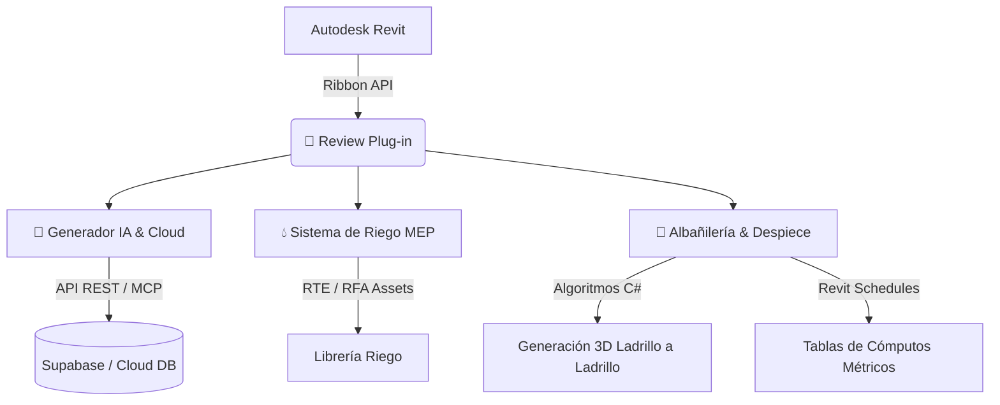

# 📕 Review Plug-in para Autodesk® Revit®

> **Suite avanzada de automatización BIM, Inteligencia Artificial, diseño de sistemas MEP (Riego) y modelado de alta precisión para Albañilería.**

---

## 📌 Descripción General

**Review Plug-in** es una extensión integral desarrollada en .NET para Autodesk Revit® diseñada para optimizar los flujos de trabajo de arquitectura e ingeniería. El complemento combina la potencia de **Inteligencia Artificial generativa**, conectividad en la nube mediante **Supabase/MCP**, automatización de **Sistemas de Riego (MEP)** y despiece geométrico avanzado de **Albañilería y Cómputos Métricos** en tiempo real.

---

## 🛠️ Desglose de Funciones y Capacidades (Paso a Paso)

El plugin se integra de manera nativa en la cinta de opciones (Ribbon) de Revit a través de la pestaña **📕 Review**, dividida en 4 módulos o paneles especializados:

---

### 🤖 1. Panel: Generador IA & Integración Cloud

Este panel integra servicios backend y modelos generativos para automatizar la parametrización de elementos 3D, exportación de datos BIM y sincronización en la nube.

#### 1.1 🏗️ Generador Familias IA (`cmdGen`)
* **Explicación:** Herramienta interactiva que utiliza prompts y motores de IA para generar y parametrizar componentes RFA (familias) de manera automatizada directamente dentro de Revit.
* **Capacidades:**
  * Generación rápida de geometría y parámetros de tipo e instancia a partir de especificaciones contextuales.
  * Creación y asignación de parámetros compartidos automatizados.
  * Reducción significativa del tiempo de modelado de familias personalizadas.

#### 1.2 📊 Exportar Metadata (`cmdMCP`)
* **Explicación:** Servicio de extracción masiva de metadatos del modelo BIM hacia formatos estructurados (JSON/IFC) y bases de datos remotas.
* **Capacidades:**
  * Extracción de datos geométricos, ubicación espacial, categorías y valores de parámetros.
  * Conexión directa mediante servidor MCP/API a plataformas de base de datos como Supabase.
  * Facilita la auditoría de información, gestión de activos (Facility Management) y análisis de datos en la nube.

#### 1.3 ⚙️ Configurador Plantillas (`cmdIA`)
* **Explicación:** Entorno de configuración para estandarizar plantillas de trabajo y definir reglas de automatización aplicables a proyectos BIM.
* **Capacidades:**
  * Control de estándares de modelado y mapeo de parámetros por disciplinas.
  * Aplicación masiva de reglas de asignación y verificación de atributos.
  * Sincronización de estilos e información técnica entre diferentes proyectos.

#### 1.4 📝 Asistente Tablas IA (`cmdSchedulesIA`)
* **Explicación:** Asistente inteligente enfocado en la estructuración y creación automatizada de tablas de planificación (Schedules).
* **Capacidades:**
  * Generación de tablas de cuantificación a partir de lenguaje natural o plantillas predeterminadas.
  * Agrupación, filtrado y cálculo automático de totales y subtotales.
  * Auditoría de campos vacíos o inconsistencias de datos en las tablas del proyecto.

#### 1.5 🔄 Sincronizar Materiales (`cmdSyncMaterials`)
* **Explicación:** Conector bidireccional entre la base de datos central en Supabase y la librería de materiales de Revit.
* **Capacidades:**
  * Actualización en tiempo real de propiedades físicas, térmicas, costos y nombres de materiales.
  * Garantía de coherencia entre los datos del presupuesto de compras y el modelo BIM.
  * Importación y asignación masiva de acabados y especificaciones técnicas.

---

### 💧 2. Panel: Sistema de Riego (MEP)

Módulo especializado en el diseño, despliegue y documentación gráfica de redes e instalaciones de sistemas de riego técnico.

#### 2.1 📂 Explorador Plantilla Riego (`cmdCargarRiego`)
* **Explicación:** Gestor de contenido y biblioteca especializada de componentes paramétricos de fontanería y riego.
* **Capacidades:**
  * Carga e inserción optimizada de familias de aspersores, difusores, válvulas, tuberías y accesorios.
  * Filtro interactivo por categorías de productos y diámetros nominales.
  * Inserción asistida en niveles y superficies topográficas.

#### 2.2 🚰 Plumbing Sheet (`cmdPlumbingSheet`)
* **Explicación:** Suite de automatización para el plano de planos técnicos, esquemas unifilares y hojas de detalles MEP.
* **Capacidades:**
  * Generación automática de vistas de plano y láminas (Sheets) para redes hidráulicas.
  * Colocación automatizada de etiquetas (Tags), cotas y cuadros de leyenda.
  * Estandarización del cuadro de rotulación y organización de entregables técnicos.

---

### 🧱 3. Panel: Albañilería & Cómputos Métricos

Módulo avanzado para el despiece real de ladrillos, cálculo de morteros de pega y generación de cómputos exactos para construcción.

#### 3.1 🏭 Generar Familias de Ladrillos (`cmdGenLadrillos`)
* **Explicación:** Motor de creación de familias de mampostería real (ladrillos tolete, perforados, bloques de concreto, etc.) y capas de mortero.
* **Capacidades:**
  * Parametrización exacta de dimensiones (alto, ancho, largo) y juntas de pega (horizontal y vertical).
  * Generación de perfiles 3D y piezas de despiece (medios ladrillos, esquinas, tramas).
  * Definición de propiedades térmicas y de masa por unidad de ladrillo.

#### 3.2 🧱 Convertir Muros a Ladrillos (`cmdConvMuros`)
* **Explicación:** Algoritmo de discretización geométrica que transforma muros genéricos de Revit en aparejos reales con ladrillos individuales.
* **Capacidades:**
  * Modelado tridimensional pieza por pieza respetando la traba del muro (aparejo inglés, flamenco, soga, etc.).
  * Generación automática de capas de pega horizontal (PegaH) y vertical (PegaV).
  * Detección automática de vanos de puertas y ventanas para el ajuste y corte de bloques.

#### 3.3 📊 Crear Tablas de Cómputos (`cmdCrearTablas`)
* **Explicación:** Módulo de cuantificación detallada para presupuestos de obra civil y mampostería.
* **Capacidades:**
  * Cómputo exacto de cantidad total de ladrillos por tipo y nivel.
  * Cálculo volumétrico de mortero/pega requerido ($m^3$) considerando desperdicios.
  * Exportación inmediata de tablas de planificación a formatos compatibles con presupuestos.

---

### ℹ️ 4. Panel: Ayuda & Documentación

#### 4.1 📘 Manual & Mapa de la App (`cmdManual`)
* **Explicación:** Centro de documentación interactivo dentro de la interfaz de Revit.
* **Capacidades:**
  * Visualización del mapa mental de arquitectura del complemento.
  * Guías de uso paso a paso, tutoriales integrados y solución de errores comunes.
  * Enlaces directos a repositorios y soporte técnico.

---

## 💻 Requisitos del Sistema e Instalación

### Prerrequisitos
* **Autodesk Revit®** (versiones 2024 - 2027)
* **.NET Framework / .NET Core 8.0/10.0** (según versión de Revit)
* Servidor local Node.js / React / Python (opcional para funciones cloud MCP) o cuenta de Supabase.

### Instalación Rápida
1. Descarga el paquete de lanzamiento (Release).
2. Ejecuta como administrador el archivo `Instalador.bat`.
3. El script copiará automáticamente los ensamblados (`.dll`) y el manifesto (`.addin`) a `%AppData%\Autodesk\Revit\Addins\`.
4. Abre Revit® y selecciona **"Cargar Siempre"** al iniciar.

---

## 📐 Arquitectura del Proyecto

---

## 📄 Licencia

Este proyecto está distribuido bajo la licencia **MIT**. Para más detalles, consulta el archivo `LICENSE`.
